<div align="center">
  
  <h1>Kira</h1>
  <p><strong>Web Exploitation Suite</strong></p>
  <p>An intercepting HTTPS proxy plus a full offensive workbench:<br>
  Intercept, Repeater, Intruder, Decoder, Comparer, site map, vulnerability and<br>
  recon scanners, payloads and an AI analyst. Every engagement is kept in its<br>
  own project on this machine.</p>

  <p>
    
    
    
    
  </p>
</div>

> [!WARNING]
> Kira is an offensive security tool. Use it only against systems you own or
> have explicit written permission to test. Unauthorized use is illegal and
> unethical. You are responsible for how you use this software.

## Description

**Kira is a desktop app for testing web applications.** It runs a local
intercepting HTTPS proxy, records every request and response, and gives you one
workspace to inspect, replay, fuzz and attack that traffic. It is built for the
same jobs as Burp Suite, but ships as a native Linux application that keeps
every project and capture on your own machine.

Once the mitmproxy CA is trusted, decrypted HTTP/HTTPS traffic streams into the
dashboard over Server-Sent Events. The inspector exposes headers, bodies, status
codes, timings, TLS details, cookies, query parameters and WebSocket frames,
with viewers for text, pretty JSON, images and binary data. Requests can be
copied as cURL, and the full capture exported as HAR 1.2.

### Main tools

- **Capture and inspector:** live traffic in a virtualized list with search,
  method/status/resource-type filters, a problems-only view, pause/resume,
  follow-live and keyboard navigation.
- **Intercept:** pause proxied requests before forwarding, then continue, drop
  or edit them one at a time or in bulk.
- **Repeater:** tabs, side-by-side request/response editing, redirect
  following, diffing, history, shared variables, rewrite rules, timing runs,
  and a byte-exact Raw HTTP mode for duplicate headers, pipelining and
  request-smuggling probes.
- **Intruder:** Sniper, Battering ram, Pitchfork and Cluster bomb attacks with
  streamed results, threads, delays, encoding, filters, baseline diffing and
  soft-404 detection.
- **Scanner:** 54 web vulnerability checks and 32 recon modules, with presets
  for core, web, API, SQLi, CMS, WAF, technology and recon work. Checks run in
  parallel, reuse captured sessions, route through Tor or a custom proxy and
  accept per-scan API keys.
- **Site map:** captured traffic grouped by origin, directory, method and path,
  plus same-origin crawling, about 150 hidden-path probes, soft-404 filtering
  and JSON export.
- **Exploit toolkit:** 1,053 payloads in 64 categories with click-to-copy and
  Insert actions, plus OAST callbacks, PoCs, JWT/auth tooling, an Authorization
  matrix, fuzzing, mutations, GraphQL helpers and a Race lab.
- **Utilities:** Decoder and Comparer for encodings, hashes and side-by-side
  diffs; a real PTY Terminal with tabs and split panes; Markdown Notes with
  tags, Mermaid diagrams and request insertion.
- **AI analyst:** opt-in summaries and analysis of captures, suspicious
  requests and the active tool window, using OpenRouter, DeepSeek, local Ollama,
  LM Studio or any OpenAI-compatible endpoint.

### Projects and privacy

Kira opens on a project picker. Save captures to disk as they arrive, reopen
them later, or use a temporary in-memory project that writes nothing. Switching
projects swaps the live capture without stopping the proxy. Everything stays on
your machine: there is no account, telemetry or cloud backend. The proxy and
dashboard bind to loopback by default, the dashboard uses a strict same-origin
CSP, and the AI analyst only sends context to the provider you choose.
Third-party recon checks (Shodan, HIBP, URLhaus) are optional, and
default-credential checks, nmap OS fingerprinting and Cloudflare origin probes
are explicitly opt-in.

### Requirements and scope

Kira is a single self-contained **Linux x86-64 ELF** with the proxy core,
dashboard, scanner and recon engines embedded. It runs in a native GTK/WebKit
window and needs no language runtime, package manager or Node.js installation.
GTK 3, WebKitGTK 4.1 and a graphical X11 or Wayland session are required; there
is no headless mode. `nmap` and Tor are optional and enable matching checks.

Kira is intended for penetration tests, red-team engagements, bug-bounty work,
CTFs, lab environments and security research where you own the target or have
explicit written authorization. It is not a hosted service and does not sandbox
your actions. See [Security and legal](#security-and-legal) before you start.

---

## Contents

- [Highlights](#highlights)
- [Screenshots](#screenshots)
- [Requirements](#requirements)
- [Quick start](#quick-start)
- [Proxy and CA setup](#proxy-and-ca-setup)
- [The workbench](#the-workbench)
- [Vulnerability and recon scanner](#vulnerability-and-recon-scanner)
- [AI analyst](#ai-analyst)
- [Projects and storage](#projects-and-storage)
- [Architecture](#architecture)
- [Limits](#limits)
- [Security and legal](#security-and-legal)

## Highlights

- **Intercepting HTTPS proxy** on `127.0.0.1:8080`, backed by mitmproxy. Trust
  the CA once and decrypted HTTP/HTTPS traffic streams into the dashboard.
- **Live capture** over Server-Sent Events with a virtualized list, search,
  method/status/type filters, problem highlighting and a full request/response
  inspector.
- **Burp-style projects**: the dashboard opens on a project picker, writes
  captures to disk as they arrive and restores them after a restart.
- **Intercept** holds proxied requests in a queue and lets you continue, drop,
  continue all or drop all.
- **Repeater** with tabs, side-by-side request/response editing, redirect
  following, diffing, variables, rewrite rules, repeat/timing runs, exports and
  a byte-exact Raw HTTP mode.
- **Intruder** with Sniper, Battering ram, Pitchfork and Cluster bomb attacks,
  streamed results, thread control, delays, match/regex, baseline diffing and
  redirect handling.
- **Scanner** with 54 web vulnerability checks and 32 reconnaissance modules,
  presets, parallel jobs, Tor routing, captured-session reuse and per-scan API
  keys.
- **Site map** built from captured traffic, plus crawl and hidden-content
  discovery with soft-404 filtering and scope controls.
- **Decoder and Comparer** for encodings, hashes, identifiers and side-by-side
  diffing of two captured exchanges.
- **Terminal** with real PTY output, tabs, split panes, host autocomplete and
  per-project command logs.
- **Notes** with Markdown, tags, Mermaid diagrams, request insertion and an
  AI writing assistant.
- **Payload library** of 1,053 manual test payloads across 64 categories,
  including an advanced WAF-bypass set and request-smuggling probes, with
  click-to-copy and an **Insert** action that writes a payload straight into the
  Repeater field you were editing.
- **OAST callbacks** with an autoprobe that gives every injection point its own
  callback URL, plus an exploitation toolkit with issues, PoCs, JWT tools,
  auth comparison, an Authorization matrix, fuzzing, mutations, GraphQL
  helpers and a Race lab (HTTP/1.1 last-byte sync and HTTP/2 single-packet).
- **Opt-in AI analyst** for OpenAI-compatible providers, including local Ollama
  and LM Studio, with a same-origin streaming proxy.
- **Native desktop window** with a dark interface, thirteen accent palettes,
  six UI styles, font scaling, light/dark themes and HAR 1.2 export.

## Screenshots

| | |
|:--:|:--:|
| [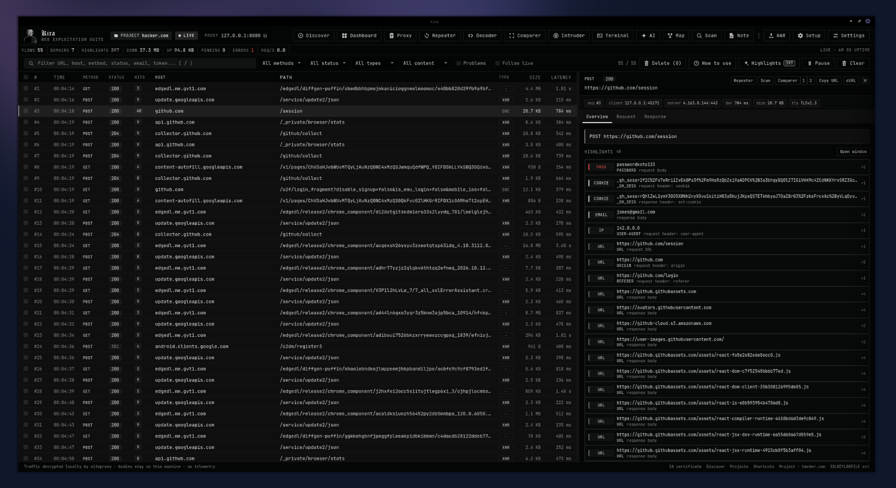](screenshots/Screenshot_20261120_214602.png) | [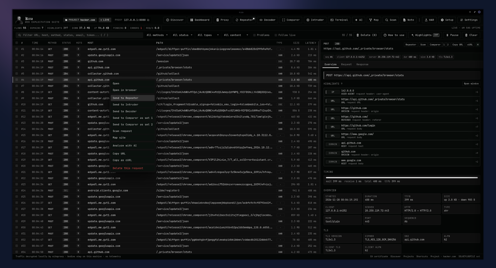](screenshots/Screenshot_20261120_214701.png) |
| **Live traffic and flow details** - filter captured requests and read headers, cookies, highlights, timing and TLS details. | **Send any request anywhere** - right-click a flow to open it in Repeater, Intruder, Decoder, Comparator or the scanner. |
| [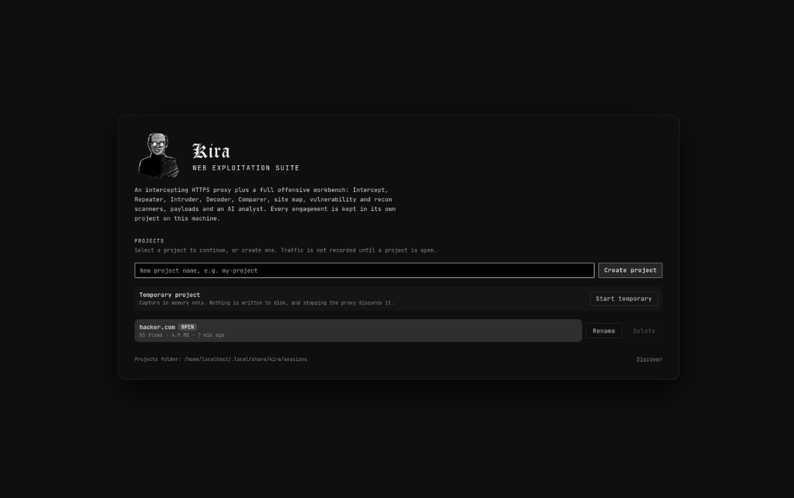](screenshots/Screenshot_20261120_214725.png) | [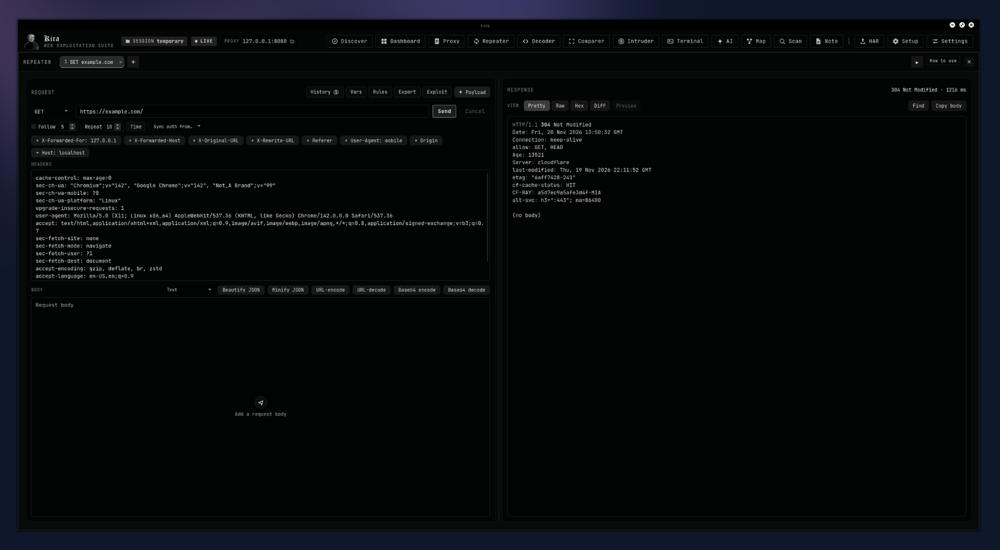](screenshots/Screenshot_20261120_215038.png) |
| **One project per engagement** - create a saved project or start a temporary in-memory one. | **Repeater** - edit and replay requests, with history, variables, rules and response diffing. |
| [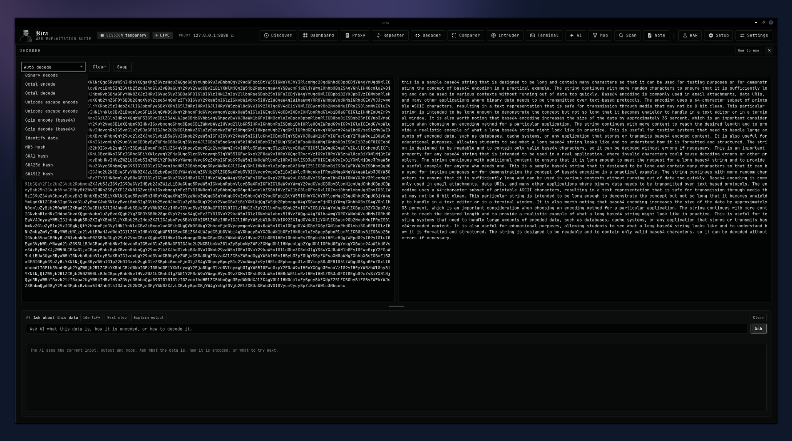](screenshots/Screenshot_20261120_220611.png) | [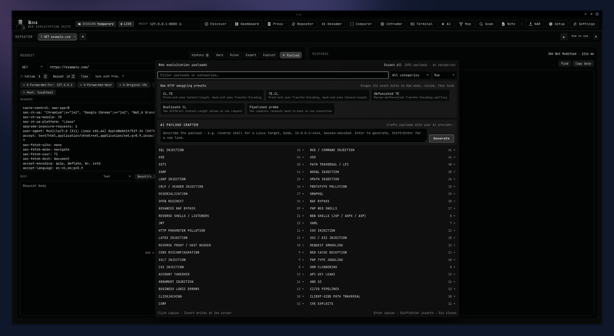](screenshots/Screenshot_20261120_215100.png) |
| **Decoder** - auto-decode Base64, hex, URL and gzip, identify hashes and ask the AI about the data. | **Payloads** - search 1,053 payloads across 64 categories or generate one with the AI payload crafter. |
| [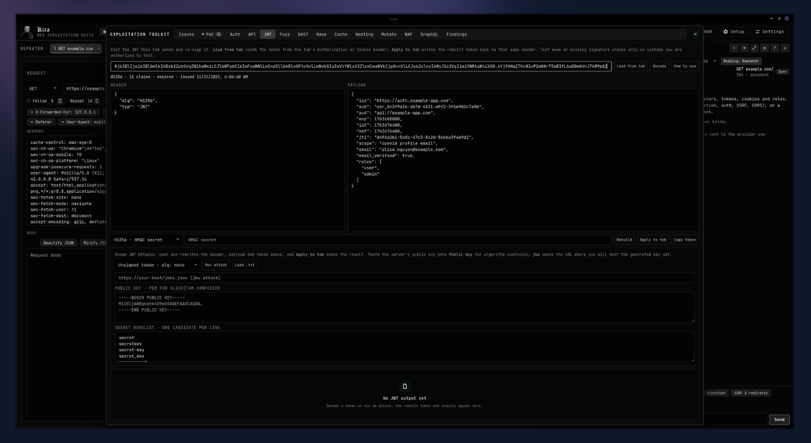](screenshots/Screenshot_20261120_221902.png) | [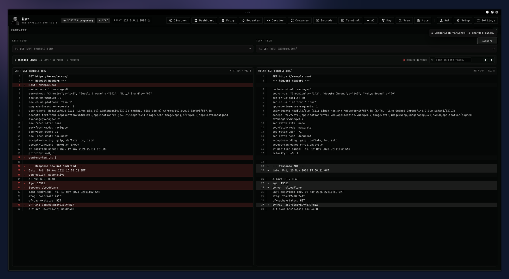](screenshots/Screenshot_20261120_215142.png) |
| **Exploitation toolkit** - decode and rebuild JWTs, test HMAC secrets and algorithm confusion, then patch the token back into the request. | **Comparator** - diff two responses line by line to spot changed headers, bodies and status codes. |
| [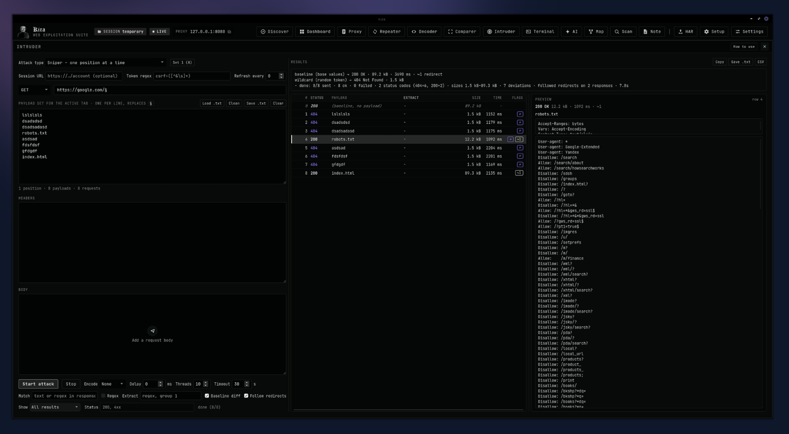](screenshots/Screenshot_20261120_215323.png) | [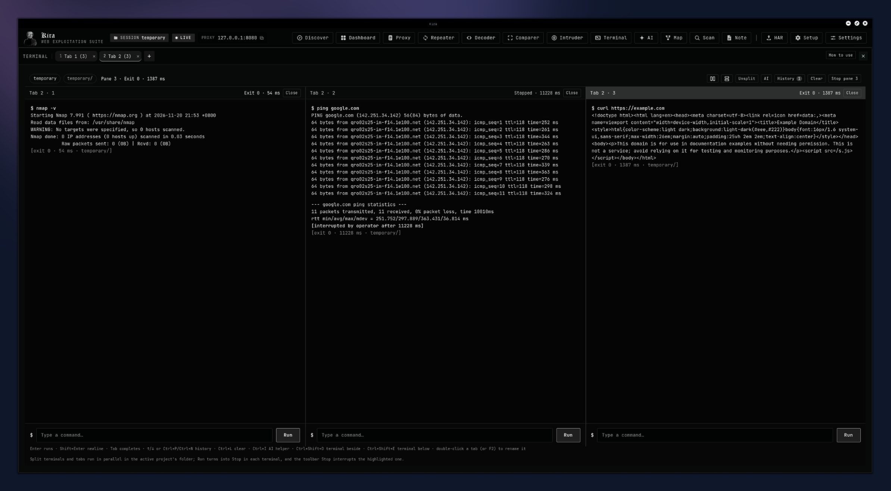](screenshots/Screenshot_20261120_215416.png) |
| **Intruder** - run sniper attacks across payload sets and compare status, size, time and response diffs. | **Terminal** - run nmap, ping, curl or any command in parallel tabs and split panes. |
| [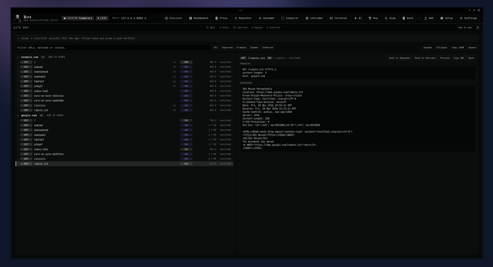](screenshots/Screenshot_20261120_215501.png) | [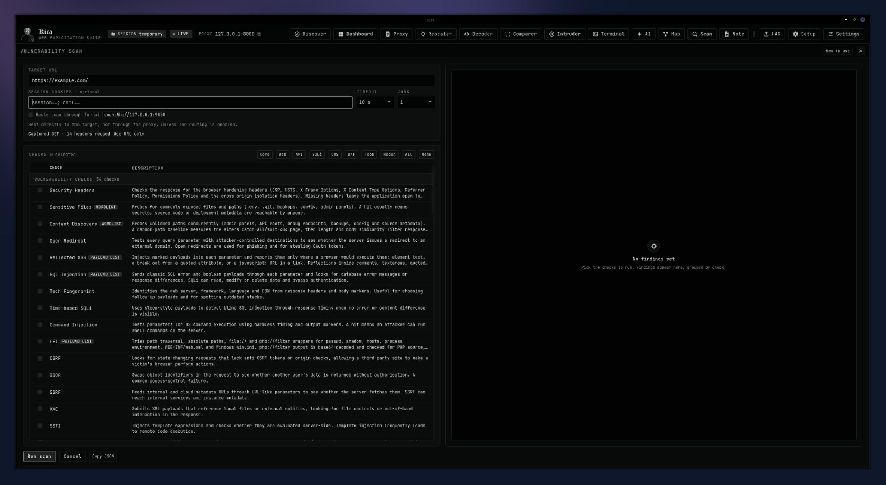](screenshots/Screenshot_20261120_215527.png) |
| **Site map** - crawl and discover URLs, then preview, replay or export the map. | **Scanner** - 54 vulnerability checks with presets and a description for every check. |
| [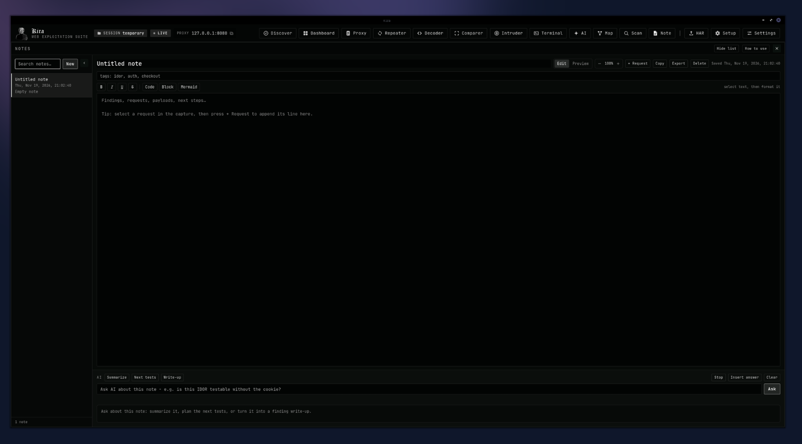](screenshots/Screenshot_20261120_215549.png) | [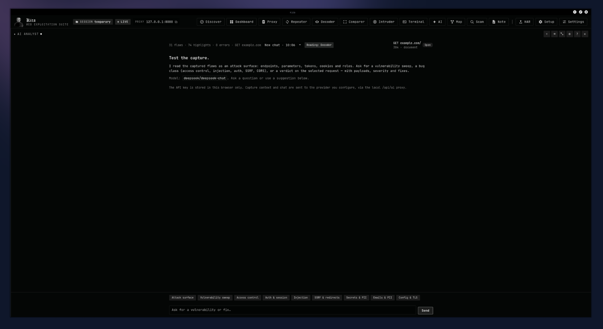](screenshots/Screenshot_20261120_220647.png) |
| **Notes** - keep Markdown notes per project and ask the AI analyst to summarize or suggest next tests. | **AI analyst** - send flow context to a local or third-party model for a vulnerability sweep, verdict or fix. |

## Requirements

Install the desktop stack:

```bash
# Debian / Ubuntu / Kali
sudo apt install python3-gi python3-gi-cairo gir1.2-gtk-3.0 gir1.2-webkit2-4.1

# Fedora
sudo dnf install gtk3 webkit2gtk4.1

# Arch Linux
sudo pacman -S gtk3 webkit2gtk-4.1
```

### Optional external tools

Kira works without these, but the matching checks and features are skipped or
degraded when they are missing:

| Tool | Enables |
| --- | --- |
| `nmap` | Service/version and OS fingerprinting recon |
| `tor` | Local SOCKS routing for scans through `127.0.0.1:9050` |

## Quick start

1. Download the `kira` ELF from the repository's page.
2. Make it executable and run it:

   ```bash
   chmod +x kira
   ./kira
   ```

3. The launcher opens the native dashboard window at
   `http://127.0.0.1:8787/` (or the next free port in `8787-8797`).
4. Create a project, open a saved one, or start a temporary in-memory project.
   Traffic is not recorded until a project is open.
5. Configure your browser to use the proxy at `127.0.0.1:8080` and trust the
   CA certificate.
6. Browse the target. Captured requests appear in the console immediately.


## Proxy and CA setup

### Point a browser at the proxy

In the dashboard, **Open browser** lists the Chromium-family browsers and
Firefox installed on this machine. Pick one to start it behind the proxy in a
temporary profile, with the mitmproxy CA trusted where the browser supports
it.

- **Firefox**: Settings -> General -> Network Settings -> Manual proxy
  configuration. Set HTTP Proxy to `127.0.0.1:8080` and enable "Also use this
  proxy for HTTPS".
- **Chrome / Edge / Brave**: use the Linux desktop proxy settings, or start
  the browser with:

  ```bash
  --proxy-server="http://127.0.0.1:8080" --proxy-bypass-list="<-loopback>"
  ```

- **Linux**: use the desktop's network proxy settings, or the Chromium flags
  above.

Disable **QUIC/HTTP3** if sites seem to bypass the proxy. In Chrome, set
`chrome://flags/#enable-quic` to **Disabled**.

### Trust the mitmproxy CA

Download the CA from the dashboard footer, from `/api/cert`, or from
`http://mitm.it` while the proxy is active.

- **Firefox**: Settings -> Privacy & Security -> Certificates -> View
  Certificates -> Authorities -> Import, and trust it for websites.
- **Chrome / Chromium**: import into the Linux trust store. Copy the PEM to
  `/usr/local/share/ca-certificates/` and run `update-ca-certificates`.
  Chromium may still require its own certificate store.
- **iOS**: install the profile from `mitm.it`, then enable full trust under
  Settings -> General -> About -> Certificate Trust Settings.
- **Android**: install it as a user certificate. Apps targeting Android 7+ may
  not trust user CAs.
- **Command-line tools**: point `curl`, `wget` or your HTTP client at
  `--proxy http://127.0.0.1:8080` and the downloaded CA bundle.

Certificate-pinned applications will fail by design and cannot be inspected
through the proxy.

## The workbench

### Traffic capture and inspector

The dashboard streams flow metadata over SSE and fetches full bodies on demand.
The list supports search, method/status/resource-type filters, problems-only
view, pause/resume, follow-live, clear, keyboard navigation and a resizable
detail panel.

The inspector shows request and response headers, bodies, status, timings, TLS
details, query parameters, cookies and WebSocket frames. Body viewers handle
text, pretty JSON, images and binary data with copy, save, raw/pretty and wrap
controls. Copy a request as cURL, copy URLs, headers or cookies, and export the
whole capture as HAR 1.2.

### Intercept

Press **i** or use the **Intercept** button to arm the queue. New proxied
requests pause before forwarding. From the queue or the Proxy workspace you can:

- **Continue** one request
- **Continue all**
- **Drop** one request
- **Drop all**

Replayed requests from the other tools bypass the queue, and the dashboard's own
API/static traffic is never intercepted.

### Repeater

Edit method, URL, headers and body, then send the request again through the
proxy. Request and response sit side by side with a draggable divider; multiple
independent sessions open as tabs.

- Response views: **Pretty**, **Raw**, **Hex** and **Preview**. Preview renders
  HTML, JSON, XML, text and images in an opaque-origin sandbox; page scripts
  may run, but they cannot reach the dashboard.
- Follow redirects the way a browser does, with a visible redirect chain.
- Diff the current response against the original or previous send.
- Find inside the rendered response with match counts.
- Keep per-tab history and shared `${name}` variables, optionally captured from
  responses with a regex.
- Apply ordered match-and-replace rules to URLs, headers or bodies before send.
- Repeat a request N times and report min/avg/median/max timing and status
  distribution.
- Send all tabs as a chain so one step's captured variable feeds the next.
- Export as cURL, fetch, raw HTTP, a response body, or an `.http` file.

**Raw HTTP mode** writes a complete request directly to a TCP/TLS socket,
bypassing the proxy and `Request.make`. It preserves duplicate headers,
`Content-Length`/`Transfer-Encoding`, obs-fold, HTTP/1.0, absolute-form targets
and custom `Host` values. Requests separated by `### PIPELINE ###` go out
back-to-back on one connection. Raw sends report time-to-first-byte and can flag
a possible desync when a second response appears. The Exploit menu stages
**CL.TE**, **TE.CL**, obfuscated TE, duplicate CL and pipelined probes.

The **Exploit** palette ships 1,053 manual test payloads in 64 categories:
SQL/NoSQL/LDAP/XPath injection, RCE and argument injection, XXE, XSS, SSTI,
traversal/LFI, SSRF, CRLF/header injection, prototype pollution,
deserialization, GraphQL, open redirect, WAF bypass (including 89 layered
evasion payloads), JWT, SAML, HTTP parameter pollution, CSV/LaTeX/SSI/ESI
injection, reverse-proxy and host-header tricks, request smuggling, CORS, cache
deception, XSLT, PHP type juggling, CSS injection, DOM clobbering, account
takeover, API-key leaks, S3, business logic, CI/CD, clickjacking, CSRF,
CVE/Log4Shell, dependency confusion, DNS rebinding, GWT, headless browsers,
hidden parameters, IDOR, management interfaces, insecure randomness, VCS
exposure, Java RMI, Kubernetes, mass assignment, OAuth, ORM leaks, prompt
injection, race conditions, ReDoS, tabnabbing, insecure uploads and WebSockets.
Click a payload to copy it, or use **Insert** (Shift+Enter on a focused payload)
to write it into the URL, headers or body field you were last editing - at the
cursor, replacing the selection, with the chosen encoding applied.

The **PoC** tab turns a response into editable XSS, SQLi, CORS, CSRF,
clickjacking, SSRF, XXE and raw-cURL artifacts. The first `curl` command can be
parsed and replayed. A larger PoC terminal runs commands in the open project
folder with a 60-second default timeout.

### Intruder

Mark positions in a URL, header or body with `§`, then supply payloads manually,
from one or more `.txt` wordlists, or by dragging files onto the list.

- Attack types: **Sniper**, **Battering ram**, **Pitchfork** and **Cluster
  bomb** (20 positions, 50,000-request cap).
- Results stream back as NDJSON while the attack runs instead of waiting for a
  batch to finish.
- Threads default to 10 (maximum 50), with an optional delay between windows.
- Optional URL/base64/hex encoding and a per-request timeout.
- **Follow redirects** walks up to five browser-like hops; cookies and
  `Authorization` are dropped when the chain leaves the origin.
- **Baseline diff** sends the same request without markers and flags status or
  length deviations.
- A random-token probe detects SPA fallback/custom 404 pages so they are
  labelled `catch-all (not found)` instead of looking like hits.
- **Match** greps bodies as plain text or regex; **Show** filters to matches or
  deviations; results export as `.txt` or CSV.

### Decoder

Browser-side encode/decode for Base64, Base64URL-style JWT, URL, hex, HTML
entities, binary, octal, Unicode escapes, ROT13 and gzip. Generates
MD5/SHA-1/SHA-256/SHA-512 hashes, auto-detects common formats and identifies
hashes and encodings.

### Comparer

Diff two captured flows side by side. Find matches case-insensitively across
both panes in one pass, see `n/total`, highlight every match and step through
them with Enter/Shift+Enter.

### Site map

A capture-driven target map, equivalent to Burp's Target -> Site map. Traffic
is grouped as origin -> directories -> method + path, with repeated requests
collapsed into one row. Links found in captured HTML that were never requested
appear as inferred entries.

- Preview captured HTML, JSON, text and images in a sandboxed frame.
- Send a map row to Repeater or Intruder, open it in a browser, copy it.
- Add a host to scope and filter the tree to the applications you care about.
- **Crawl & discover** follows same-origin links to a chosen depth and probes
  about 150 common hidden paths (admin panels, `.git`, `.env`, backups, API
  docs, actuator and more).
- A random-path baseline filters soft-404 responses so catch-all pages do not
  flood the map.
- Hidden and crawled entries are tagged; the map exports as JSON.

### Terminal

A fullscreen shell with independent tabs and split panes.

- Real pseudo-terminal output, so line-buffered programs such as `ping` print as
  they run.
- Up to four terminals per tab, arranged side by side or stacked; splitters are
  draggable and remembered.
- Each terminal's Run button becomes Stop while it is busy; the toolbar Stop
  names and targets the highlighted pane, so split windows are never ambiguous.
- Per-tab scrollback and history; tab names persist across reloads.
- Command history timeline grouped by day, with click-to-reuse.
- Prompt autocomplete reads executables on `PATH`, the host shell's history
  (`$HISTFILE`, bash/zsh/fish) and files in the project folder. Nothing is
  executed to build suggestions.
- Ctrl+C interrupts the running command's process group, escalating to
  SIGTERM/SIGKILL when needed.
- Every command and result is appended to `terminal.log` in the project folder.

### Notes

Per-engagement notes stored in the browser: multiple notes with autosave,
search, tags, Markdown preview and Mermaid diagrams. Insert the selected request,
copy or export notes as Markdown, and ask the AI assistant to summarize, propose
next tests or rewrite a finding.

### AI analyst

An opt-in chat panel reachable from every window with the **AI** button or the
**a** shortcut. It can summarize the capture, list top hosts, hunt for suspicious
requests, explain decrypted highlights and analyze a selected flow.

The analyst reads decoded packet previews, not just metadata: complete headers
with explicit omission markers, HTML page summaries (title, visible text, forms,
links and scripts), pretty-printed JSON, form bodies and bounded WebSocket frame
samples. Every size, capture limit and context truncation is labelled, so the
model can tell a partial preview from an empty packet.

- **OpenRouter** and **DeepSeek** use an API key.
- **Ollama** and **LM Studio** run locally and need no key.
- **Custom** accepts any OpenAI-compatible `chat/completions` endpoint.

The **Read window** control attaches the window you are looking at (Repeater,
Intruder, Decoder, Comparer, Terminal, Site map, Scanner, Notes) to the next
question. Window contents are sent as untrusted, size-capped data only when the
control is enabled.

The API key is stored in the browser's `localStorage`, not on disk. Chat and
capture context go through the local `/api/ai` proxy to the provider you choose;
the proxy relays but does not log or persist them. Treat decrypted traffic as
sensitive and use a provider you trust, or keep everything local.

## Vulnerability and recon scanner

The **Scan** workspace runs bundled checks against a target URL. Open it from
the toolbar or from a captured request; opening from a request pre-fills the URL
and reuses its cookies, so checks run against the authenticated session the
proxy already captured. The deep SQLi check also replays the captured method,
headers and a form/JSON body to test POST parameters.

### Coverage

**Web vulnerabilities: 54 checks**

23 core checks:

- Security headers, HSTS grading and cookie-flag auditing
- SQL injection: error, time, blind, deep error/boolean/time/UNION
- NoSQL injection, XSS, SSTI, SSRF, XXE, LFI, command injection, CRLF
- Host-header injection, CORS, CSRF, IDOR, open redirect
- Directory listing, sensitive files, JWT analysis, technology fingerprint
- Content Security Policy grading and clickjacking

31 advanced checks:

- GraphQL introspection, robots.txt/sitemap disclosure and backup-file probing
- Web cache deception and WebDAV method detection
- LDAP/XPath injection, Shellshock and PHP code injection
- Exposed logs, dotfiles, SQL dumps and password lists
- Information disclosure: PII, internal IPs, source comments and verbose errors
- phpinfo/Apache server-status exposure and RFI
- HTML injection, secrets in responses and CMS scanning
- WAF detection and full technology inventory
- Header-vector injection, XST and session fixation
- Struts2 S2-045 and encoded path traversal
- OAuth flow weaknesses, insecure file upload and deserialization
- Prototype pollution

**Reconnaissance: 32 modules**

- IP/geolocation, ASN/network, DNS records and WHOIS
- SSL/TLS certificate, version and cipher probing
- Server/CDN identification and HTTP method discovery
- Port scanning with banners and service audit
- Subdomain enumeration, reverse IP, alternative sites and shared DNS
- User-Agent cloaking and AXFR zone-transfer attempts
- Email/DNS security, subdomain takeover and email harvesting (optional HIBP)
- Wayback archive, `security.txt`, Shodan InternetDB and passive DNS history
- Traceroute, threat-intelligence/DNSBL and Tor-exit checks
- DuckDuckGo dorking and account aliases
- Subnet classification and private-network sweeps
- Anonymous service audit and honeypot scoring
- Opt-in default-credential checks
- Opt-in OS fingerprinting and Cloudflare origin discovery
- Full Shodan host record and nmap service versions

### Scan controls

- Presets: **Core**, **Web**, **API**, **SQLi**, **CMS**, **WAF**, **Tech**,
  **Recon**, **All** and **None**.
- Run 1, 2, 4 or 8 independent checks in parallel, each with its own requester
  and cookies.
- Route checks through a local SOCKS proxy/Tor (`127.0.0.1:9050`) or a custom
  proxy.
- Replace built-in probes with custom payloads; supply path wordlists and
  extension lists for content discovery.
- Blind command-injection, SSRF, SSTI and XXE branches receive a per-scan
  callback origin from the OAST tunnel (or a supplied `oastBase`). If that origin
  is reachable only on loopback and the target is not, the report says so
  instead of treating the missing callback as a pass.
- Provide third-party keys per scan for Shodan, HIBP and URLhaus. Per-scan keys
  stay in memory and are never written to reports, projects or logs; an empty
  field falls back to the matching environment variable.
- Results are grouped per check with severity, timing and text filters. Export
  the report as JSON.

Checks that need a missing external tool or optional package report why they
were skipped instead of failing the whole scan.

## Projects and storage

Kira opens on a project picker, like Burp asking which project to use before
it starts. Traffic is not recorded until a project is open.

- **Create project** starts a fresh saved capture.
- **Open** restores flows, bodies, timings, findings and WebSocket frames.
- **Delete** removes a closed project (click **Delete**, then **Confirm**).
- **Start temporary** captures in memory only; nothing is written and the
  capture is discarded when the proxy stops.
- Switching projects swaps the live capture in place while the proxy keeps
  running.
- **Clear** empties the current project on disk as well.
- The footer names the open project and shows its file path on hover; the
  picker footer shows the projects folder.

## Architecture

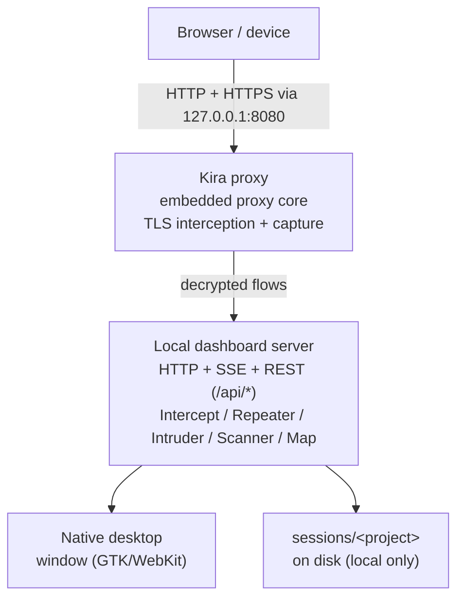

## Limits

- Up to **5,000 flows** in memory, **512 KiB** of body preview per
  request/response, **8 MiB** maximum inspected body, and capped WebSocket
  frames. Truncation and eviction are shown in the UI.
- Only HTTP(S) traffic that actually uses the proxy is visible.
  Certificate-pinned applications and clients that ignore the proxy will not
  appear.
- **QUIC/HTTP3** is not proxied by the standard HTTP proxy setup; disable it if
  a site seems missing.
- WebSocket frames are captured after the handshake. Binary frames are shown as
  hex and previews are capped.
- The dashboard has no authentication and no TLS on the local listener. Keep it
  on loopback or behind a trusted boundary.
- The AI analyst sends the context you attach to the provider you configure.
  Local providers keep it on your machine; third-party providers may log it.
- Third-party recon checks (Shodan, HIBP, URLhaus) send target data to those
  services. Default-credential, `nmap -O` and Cloudflare origin probes are
  opt-in.

## Security and legal

- Use Kira **only** on assets you own or are explicitly authorized to test.
- Captured traffic and project files can contain passwords, session cookies,
  API keys, personal data and other sensitive material. Protect them, encrypt
  them at rest if needed, and delete them after the engagement.
- Do not expose the dashboard or proxy to the internet or an untrusted LAN.
- The AI analyst and optional third-party checks send data to third parties.
  Review those providers' policies before use.
- The author and contributors are not responsible for misuse or damage caused
  by this software. You are responsible for complying with applicable laws,
  contracts and rules of engagement.


> Add the license you intend to distribute Kira under before publishing
> releases or accepting contributions.
